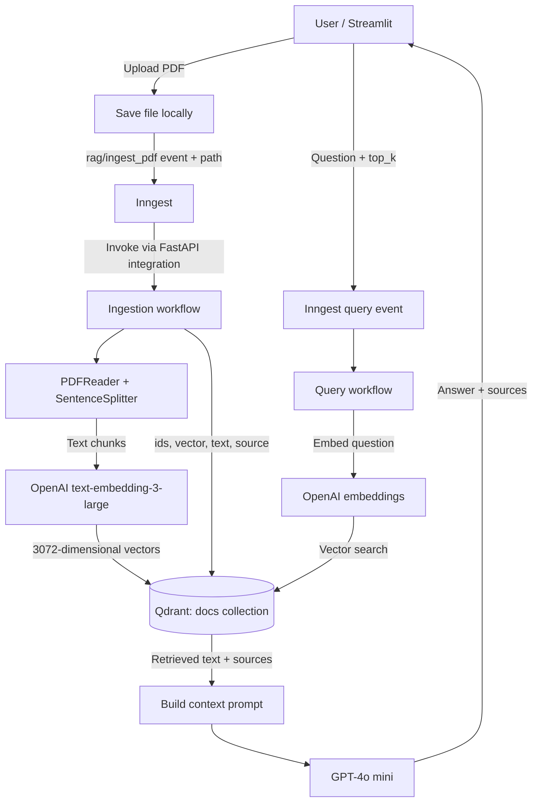

# Document Q&A with RAG — Architecture & Code Study

> **Project status:** guided, code-level study and technical analysis of an existing Python RAG tutorial. The architecture below reflects the provided tutorial repository; it is **not presented as an independently engineered or production-deployed product**.

A learning repository exploring how an event-driven Retrieval-Augmented Generation (RAG) application ingests PDF documents, embeds document chunks, retrieves relevant passages, and uses an LLM to answer questions.

## Architecture

**Retrieval is not generation:** the embedding model represents text as vectors, Qdrant finds similar chunks, and GPT-4o mini receives the **original text** of retrieved chunks as context.

## Technology roles

| Component | Responsibility |
|---|---|
| Streamlit | Python UI: upload, query form, progress and results |
| FastAPI | Hosts the HTTP integration for Inngest functions |
| Inngest | Event triggering, workflow steps and run tracking |
| LlamaIndex PDFReader / SentenceSplitter | Extract text and split it into chunks |
| OpenAI `text-embedding-3-large` | Embed chunks and queries (3072 dims in this implementation) |
| Qdrant | Store `(id, vector, payload)` points; cosine vector search |
| GPT-4o mini | Generate answers from retrieved context |
| Pydantic | Type and validate workflow outputs |

## Code map (original tutorial)

- `streamlit_app.py`: `save_uploaded_pdf`, `send_rag_ingest_event`, `send_rag_query_event`, `fetch_runs`, `wait_for_run_output`.
- `main.py`: `rag_ingest_pdf`, `_load`, `_upsert`, `rag_query_pdf_ai`, `_search` and `inngest.fast_api.serve`.
- `data_loader.py`: `load_and_chunk_pdf`, `embed_texts`.
- `vector_db.py`: `QdrantStorage.__init__`, `.upsert`, `.search`.
- `custom_types.py`: Pydantic schemas for the step outputs.

## Guided reading order

1. [Step 1 — Streamlit and event payloads](docs/01-streamlit-events.md)
2. [Step 2 — FastAPI, Inngest and Pydantic](docs/02-backend-inngest.md)
3. [Step 3 — PDF extraction, chunking and embeddings](docs/03-ingestion-embeddings.md)
4. [Step 4 — Qdrant storage and retrieval](docs/04-qdrant-retrieval.md)
5. [Step 5 — Prompt construction and generation](docs/05-generation.md)
6. [Engineering limitations and upgrade backlog](docs/06-limitations-next-steps.md)
7. [Interview questions and exercises](docs/07-interview-prep.md)
8. [Running and verifying the tutorial](docs/08-setup-verification.md)

## Learning outcomes

- Trace a PDF and a query across UI, events, functions, embeddings, vector DB and LLM.
- Distinguish HTTP endpoints, Python imports, events, Pydantic models and vector payloads.
- Explain chunking, semantic search, `top_k`, prompt context and common RAG failure modes.
- Identify which engineering improvements remain to be tested.

## Important scope and provenance

This repo's documentation was prepared as an **annotated study of a tutorial implementation**. Reading and explaining a tutorial is valuable, but it is not evidence of having independently built, deployed, benchmarked or sold the application. See [source and attribution](SOURCE_AND_ATTRIBUTION.md). The `docs/` examples are explanatory; they are not evidence of executed integration tests.

## Model selection

The tutorial selects `text-embedding-3-large` and `gpt-4o-mini`. These are **separate models** for different tasks; the embedding model is **not inherently required by or specially paired with** GPT-4o mini. An alternative embedding model could be used if both ingestion and queries use the same compatible vector space and Qdrant collection dimensions are reconfigured / vectors re-indexed. See [engineering notes](docs/06-limitations-next-steps.md).
